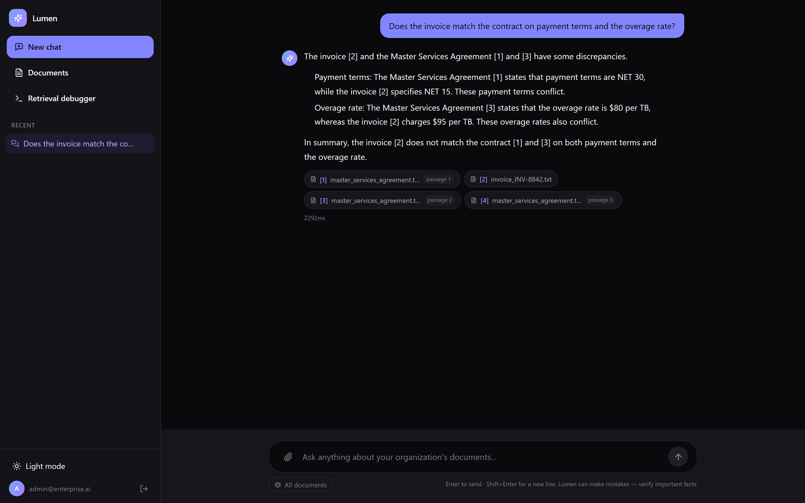
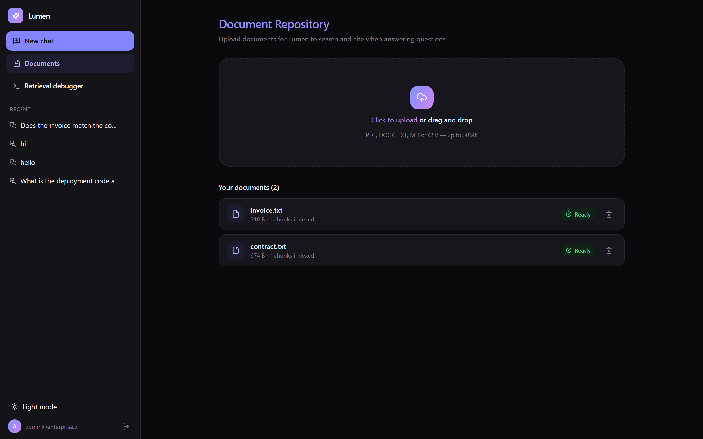
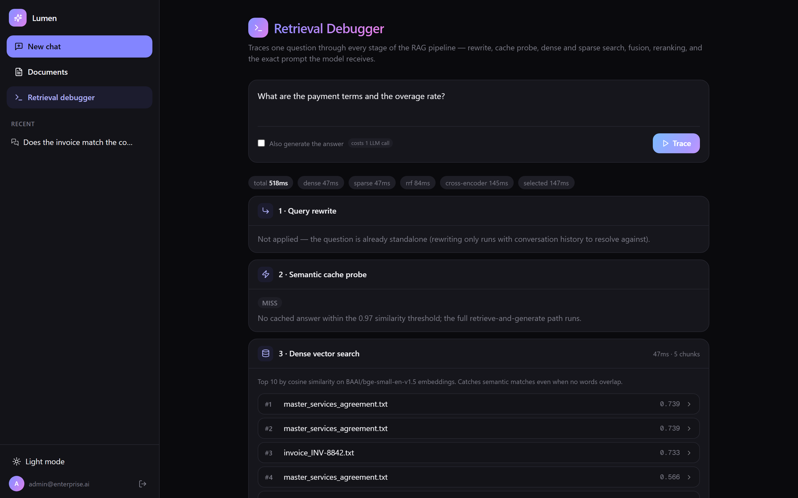

# Lumen

Self-hosted document assistant combining hybrid retrieval, semantic caching, asynchronous ingestion, multi-provider LLM fallback, and streaming answers with source citations.

[Live demo](https://lumen-three-nu.vercel.app)

## Problem

A document QA system needs more than an LLM call. Retrieval quality, ingestion latency, cache behavior, tenant isolation, and failure handling all affect the backend's correctness and user experience.

Lumen treats retrieval as an observable pipeline rather than a black box.

## Architecture

~~~text
                     +------------------+
                     |    Next.js UI    |
                     +--------+---------+
                              |
                         HTTPS / SSE
                              |
                     +--------v---------+
                     |    FastAPI API   |
                     +---+----------+---+
                         |          |
                  chat pipeline    documents
                         |          |
             +-----------+          +----> PostgreSQL
             |           |
             v           v
          Redis       Qdrant
       cache/rate     retrieval
         limits
             |           |
             +-----+-----+
                   |
                   v
             LLM providers
                   |
              streamed answer
~~~

Document ingestion runs asynchronously:

~~~text
Upload -> parse -> chunk -> embed -> index
                     |
                     +-> PostgreSQL
                     +-> Qdrant
~~~

## Engineering decisions

- **Hybrid retrieval:** combine dense retrieval with BM25 and fuse rankings with Reciprocal Rank Fusion.
- **Cross-encoder reranking:** improve ordering of retrieved candidates before generation.
- **Semantic caching:** avoid repeating expensive work for near-duplicate queries.
- **Content-addressed uploads:** uploads are SHA-256 hashed; identical bytes return the existing document instead of being stored, embedded and indexed again (which would also flush the tenant's answer cache).
- **Idempotent ingestion:** chunk ids derive from (document, position), so a retried Celery task overwrites instead of duplicating chunks, and failed documents can be reprocessed from storage without re-uploading.
- **Query-embedding memoization:** a bounded per-process LRU means a question is embedded once, not separately for cache lookup, retrieval and cache write.
- **SSE streaming:** return generated output incrementally instead of waiting for the complete response.
- **Celery ingestion:** move document parsing, embedding, and indexing off the request path.
- **Tenant isolation:** enforce organization-level document boundaries in the backend.
- **Retrieval evaluation:** measure Recall@k, MRR, and NDCG against a fixed golden dataset.
- **Observability:** expose Prometheus metrics and a retrieval debugger for pipeline inspection.

## Screenshots

| Documents | Retrieval debugger |
|---|---|
|  |  |

## Tech stack

| Layer | Technologies |
|---|---|
| Frontend | Next.js, React, Tailwind |
| Backend | FastAPI, SQLAlchemy, Alembic |
| Data | PostgreSQL, Redis, Qdrant |
| Async processing | Celery |
| Retrieval | Dense embeddings, BM25, RRF, cross-encoder |
| AI | LiteLLM, Gemini, OpenAI, Anthropic, Groq, Ollama |
| Infrastructure | Docker, S3 or local disk storage, Prometheus, Grafana |

## Run locally

Requires Docker with the Compose plugin, and an API key for at least one LLM provider (a free [Gemini key](https://aistudio.google.com/apikey) works).

~~~bash
git clone https://github.com/colin-110/lumen.git
cd lumen
make setup                      # creates backend/.env and frontend/.env.local
# edit backend/.env and set GEMINI_API_KEY (or another provider's key)
docker compose up --build -d    # migrations run automatically on first start
make seed                       # creates the admin account from backend/.env
~~~

| Service | URL |
|---|---|
| App | http://localhost:3000 |
| API docs | http://localhost:8000/docs (or your `BACKEND_HOST_PORT`) |
| Grafana (with `--profile monitoring`) | http://localhost:3001 |

Sign in with `FIRST_SUPERUSER_EMAIL` / `FIRST_SUPERUSER_PASSWORD` from `backend/.env`, or register a new account.

## Tests and evaluation

These run on the host: install dependencies first with `make install-backend install-frontend` (Poetry, Python 3.12, Node 20).

~~~bash
make test-unit         # backend unit tests, no services needed
make test              # full backend suite (needs Postgres + Redis) and frontend tests
make lint
make eval-retrieval    # Recall@k, MRR and NDCG against the golden dataset
~~~

## What I focused on

The main engineering goal was to make retrieval behavior measurable and debuggable. The system exposes the stages from query rewriting through caching, retrieval, fusion, reranking, and generation so changes can be evaluated systematically rather than judged only from a few manual prompts.

## License

Apache-2.0
